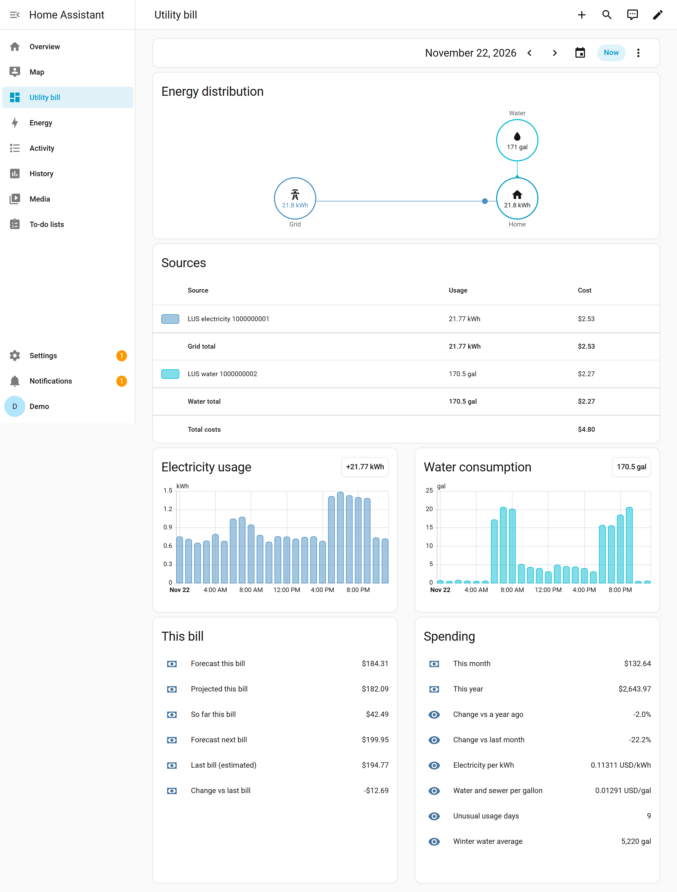
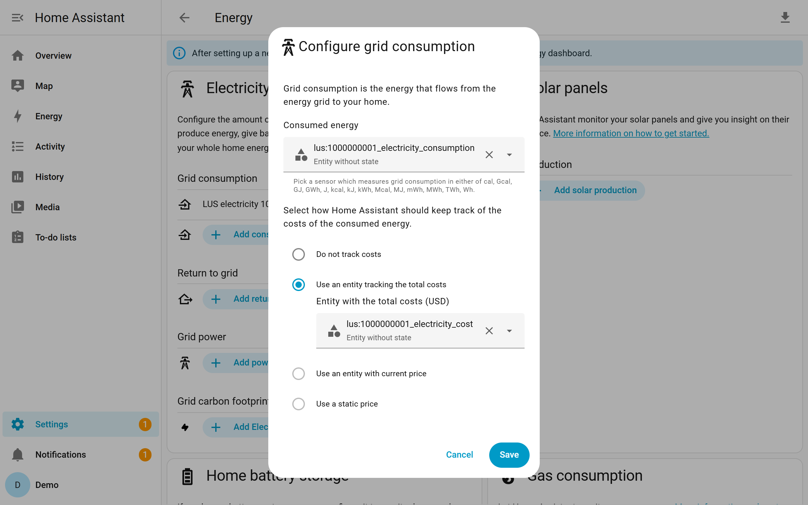
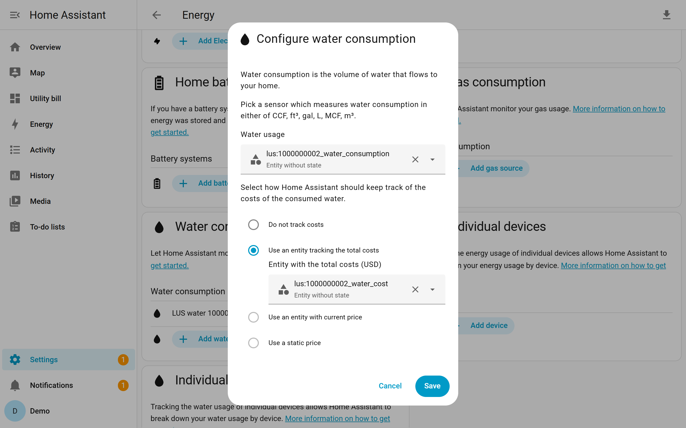
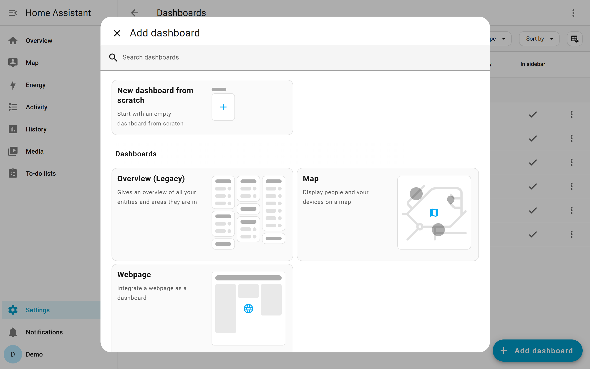
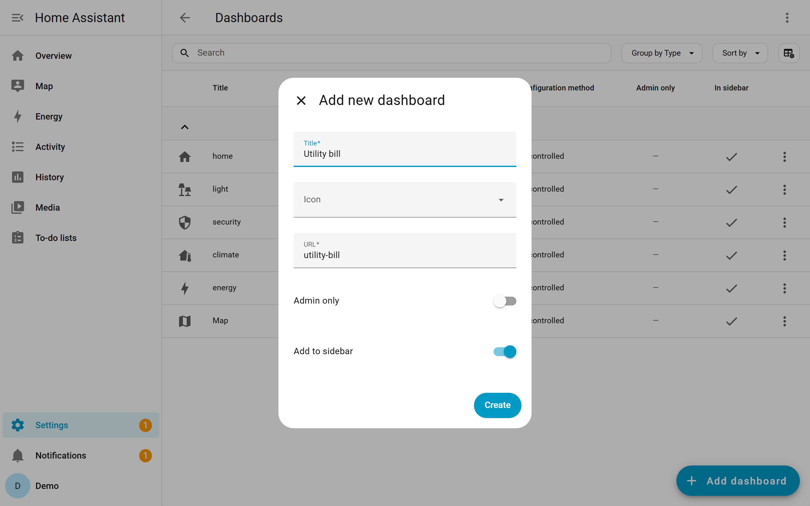
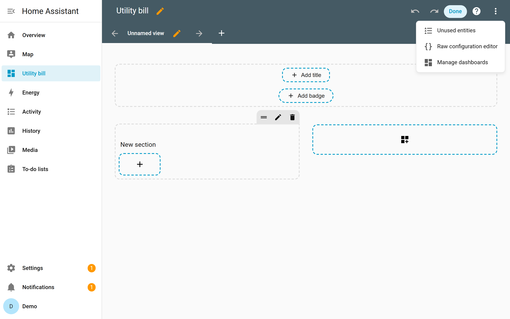
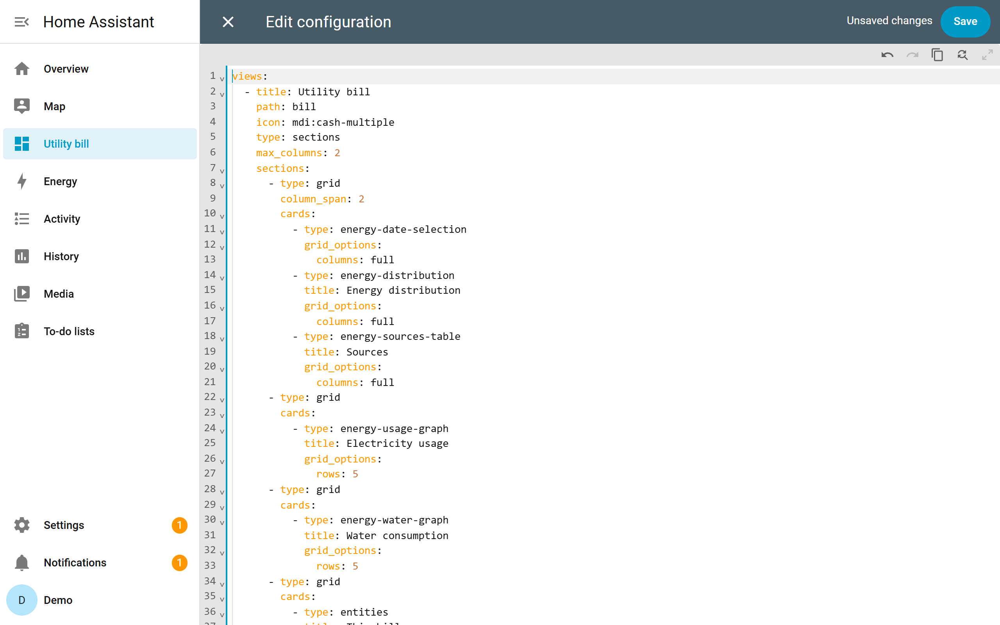

# LUS (Lafayette Utilities System) for Home Assistant

Imports smart-meter usage from the LUS customer portal (`dss-lus.opower.com`)
into Home Assistant long-term statistics, for use in the Energy dashboard.

The built-in Opower integration doesn't list LUS: LUS runs Opower's DSS portal,
which has its own login and API path. This integration talks to it directly.

**Quick start:** [Install](#install) it, then follow
[Set up the Utility bill dashboard](#set-up-the-utility-bill-dashboard): a
five-minute, click-by-click guide with screenshots that ends with one page
showing your usage graphs, this bill's forecast and your spending. A
[TL;DR](#tldr) with the paste-ready dashboard is at the end of that section.

> **Disclaimer:** This is an unofficial, independent project. It is not
> affiliated with, endorsed by, or supported by Lafayette Utilities System
> (LUS), the Lafayette Utilities Authority, or Opower/Oracle. The LUS name
> belongs to its owner and is used only to identify the utility; the
> integration's icon is a generic design. Cost figures are estimates; your LUS
> bill is the authoritative amount. The integration reads the same customer
> portal you sign in to, so changes to that portal may break it.

## What it imports

One statistic per meter with interval data on the account's primary LUS account:

| Meter | Portal resolution | Statistic | Unit |
|---|---|---|---|
| Electric | 15 min (summed to hours) | `lus:<id>_electricity_consumption` | kWh |
| Water | Hourly | `lus:<id>_water_consumption` | gal |
| Wastewater | Hourly | `lus:<id>_wastewater_consumption` | gal |

- The first run backfills from the meter's first smart-meter read (LUS data
  starts around September 2023), 30 days per request.
- After that it checks every 6 hours. The portal lags about 1 day for electric
  and 1–2 days for water, so the newest data is always a day or two old.
- An hour is imported only once all of its reads are in, and an hour with no
  reads yet holds back the hours after it, so partial or late hours are never
  stored short or skipped. After 48 hours, hours with missing reads are
  imported as they are and hours with none are left out of usage.
- The portal does skip hours now and then. A skipped hour still counts in the
  cost statistics, with no usage: it carries its share of the fixed charges,
  and the other meter's charges for it still count toward the total.
- Wastewater is billed from the water meter, so its numbers usually match water.

## Estimated cost

The portal's interval reads carry no cost, so the integration estimates it
from your bill's rates and adds three more statistics:

| Statistic | What it includes |
|---|---|
| `lus:<id>_electricity_cost` | kWh × (energy + fuel adjustment) + electric customer charge |
| `lus:<id>_water_cost` | Tiered water + wastewater volume (with the summer discount) + water, state and wastewater fixed charges |
| `lus:<account>_total_cost` | Electricity + water costs + garbage, through the newest hour both meters have reported |

- Monthly fixed charges are spread evenly over the real elapsed hours of each
  billing cycle, so a cycle crossing a daylight-saving change still gets exactly
  one fixed charge.
- Water and wastewater follow LUS rate schedules W1 and S1. In April–November
  bills, water above the tier-1 limit is charged at the tier-2 rate, and
  wastewater is charged on the tier-1 limit or actual use, whichever is less
  (the bill's "Summer Discount" line), but never on less than 75% of actual
  use. December–March bills charge every gallon at the tier-1 rate and all of
  it for wastewater.
- The tier-1 limit is the household's average water use over the previous
  December–March bills, which LUS recalculates each year. By default (a limit
  of 0 in the options) the integration works it out from the water meter's
  reads for those bills. The **Winter water average** sensor on the LUS device
  exposes the result in gallons so you can compare it with your bill. Its
  `winter_year` attribute is the year of the March bill and its
  `water_meter_id` identifies the source meter. The sensor uses the latest
  completed winter (the current year from April through December, or the prior
  year from January through March). It remains unknown when there is no water
  meter, no usable reads, or the winter is incomplete. A bill missing up to a
  day of reads is scaled up to its whole cycle; one missing more is left out of
  the average.
  Until the March bill's reads are all in (at most a week), the cost of later
  hours waits for them. With no reads from that winter, summer bills have no
  tiers and are charged wastewater on every gallon.
- To use your bill's tier-1 limit instead, enter it in the options. It then
  applies to later summers too, until a later set of rates changes it, so
  update it when LUS recalculates it or set it back to 0.
- Billing cycles are each meter's own bill periods, read from the portal: a
  period runs from midnight after one meter read to midnight after the next,
  and LUS reads on a different day some months. Water tiers reset at the start
  of each water period. The open cycle is taken to end a month after the last
  bill; once the next bill shows its real end, that cycle's stored costs are
  recalculated. Projected month-end dates clamp in shorter months without
  permanently drifting earlier in later months. A day set in the options
  instead makes every cycle start at midnight on that day.
- Checked against the October 2026 bill: with that bill's tier-1 limit of
  20,470 gallons, the model reproduces its $475.39 in current charges to
  within a cent when usage is spread across the cycle.

**Using it in the Energy dashboard:** on the LUS electricity entry choose
"Use an entity tracking the total costs" and pick `LUS electricity cost …`; do
the same for water with `LUS water cost …`. Don't add the wastewater meter as a
water source, or every gallon counts twice. To see the whole estimated bill,
add a Statistics graph card for `LUS total cost …` with the "change" stat and a
monthly period.

**Account sensors:** an **LUS** device with five sensors, which the Overview
dashboard shows automatically (or add them to any dashboard):

| Sensor | Value |
|---|---|
| Estimated bill this period | Estimated charges since the last meter read, through the newest data |
| Projected bill this period | That amount scaled to the whole billing period at the same hourly rate |
| Projected change from last bill | Projected bill minus the previous completed bill; positive means the projection is higher, negative means lower, and zero means unchanged |
| Estimated last bill | The most recent closed billing period; compare it with your bill |
| Winter water average | Calculated average gallons per December–March bill for the latest completed winter |

The four bill sensors have `period_start`, `period_end`, `data_through` and
`complete` attributes. They include every charge the cost model covers, garbage
included, and update with the statistics every 6 hours. The projected change is
unknown until the current period has data and the previous period is complete.
Because the LUS portal typically lags by a day or two, projections and their
change trail current usage by the same amount.

## Spending insights

Nine more sensors on the **LUS** device answer what a bill doesn't. They are
worked out from the usage history and your bill rates on every update, and
[docs/MATH.md](docs/MATH.md) gives the formula and a worked example for each.

| Sensor | Value | Attributes |
|---|---|---|
| Cost this month | Calendar month so far | `electricity`, `water`, `wastewater`, `garbage`, `fixed`, `variable`, `kwh`, `gallons`, plus `months` (the last 13) and `billing_periods` (the last 13 bills) |
| Cost this year | Calendar year so far | The same breakdown, plus `years` |
| Electricity cost per kWh | All-in $/kWh on the last complete bill, customer charge included | `usage_only_rate` (what one more kWh costs), `fixed_share` |
| Water and wastewater cost per gallon | All-in $/gal on the last complete bill | `per_1000_gallons`, `water_only_rate`, `usage_only_rate` |
| Cost change from the month before | % change, last complete month against the one before | Each utility, `kwh`, `gallons`, `per_day`, `drivers` (how much came from usage, rates and fixed charges), `month_to_date` |
| Cost change from a year ago | % change, last complete month against the same month last year | The same, plus `year_to_date` |
| Forecast bill this period | Expected bill for the current billing period | `low`, `high`, each utility, `kwh`, `gallons`, `factors` |
| Forecast next bill | Expected bill for the period after | The same, with `method` `seasonal` or `trend` |
| Unusual usage days | Days in the last 30 with a spike or a likely leak | `latest_explanation`, `latest_cause`, `excess_cost`, `anomalies` |

- **Forecast or projected?** *Projected bill this period* scales the cost so
  far to the whole period. *Forecast bill this period* fills the rest of the
  period with your recent daily usage, adjusted for how the season moved over
  the same days last year, and prices the whole period as one bill. That puts
  tier 2 water and the summer wastewater discount where they will be billed,
  so prefer it; the projected sensor is kept for existing dashboards.
- **Comparisons need history.** Month over month needs two complete months;
  year over year needs the same month a year earlier. Until then those sensors
  are unknown. Three years of usage are kept for this.
- **Unusual days** compares each day with the four weeks before it and names a
  likely cause from when the extra was used: a few heavy hours, a raised
  overnight level, a hot afternoon, an irrigation run. Water flowing in every
  hour for 24 hours is reported as a likely leak however small. Causes are
  read from the usage pattern only; there is no weather data behind them.
- The first update after a restart reads the stored usage statistics once;
  after that the history is kept in memory.

A Markdown card for the month by utility:

```yaml
type: markdown
content: >
  
  | Utility | This month |

  |---|---:|

  | Electricity | ${{ state_attr(s, 'electricity') }} |

  | Water | ${{ state_attr(s, 'water') }} |

  | Wastewater | ${{ state_attr(s, 'wastewater') }} |

  | Garbage | ${{ state_attr(s, 'garbage') }} |

  | **Total** | **${{ states(s) }}** |
```

And an automation trigger for a new unusual day:

```yaml
trigger:
  - platform: state
    entity_id: sensor.lus_unusual_usage_days
    attribute: latest_date
action:
  - service: notify.notify
    data:
      message: "{{ state_attr('sensor.lus_unusual_usage_days', 'latest_explanation') }}"
```

**Updating rates:** Settings → Devices & services → LUS → Configure.
1. Pick the date the rates take effect. It defaults to the start of the most
   recently closed billing cycle, which is the period on the bill you just
   received.
2. Enter the bill's rates. The form starts with the rates already in effect on
   that date.

Each set of rates applies from its date until the next later set, so you can
also go back and correct an older period without touching later ones. On the
next update, stored costs from that date on are recalculated and overwritten;
usage isn't touched. Hours before the earliest dated set use the original,
undated rates (the October 2026 bill unless you changed them), so backfilled
history before your first bill entry is only approximate.

**Upgrading from 0.4.0:** sets of rates still holding 0.4.0's guessed summer
months (May–October) move to April–November, and every stored cost is
recalculated on the first update under the corrected water and wastewater
rules. Months you changed yourself are kept. A tier-1 limit saved with your
rates (20,470 gallons unless you changed it) is kept too; set it to 0 to have
it worked out from the meter.

**Upgrading to 0.5.1:** every stored cost is recalculated once on the first
update, so past hours the portal skipped get their fixed charges back and the
total stops leaving out the other meter's charges for them.

**Upgrading to 0.6.0:** sets of rates still holding the old default billing
day (23) switch to 0, your bills' own dates, and every stored cost is
recalculated once on the first update. Other days you changed yourself are
kept. An explicitly chosen historical day 23 is indistinguishable from the old
default, so it also migrates to your bills' dates; reselect 23 afterward to
keep using it.

**Not modeled:** taxes (currently $0 on the bill), late fees, payments and
credits, and any adjustment LUS makes to a winter average for unusual
weather. The worked-out winter average follows the water meter's own bill
periods, but sums its hourly reads, which can run a few percent under the
gallons billed; if it differs from the tier-1 figure on your bill, enter
that figure instead.

## Install

1. Copy `custom_components/lus` into your Home Assistant `config/custom_components/`
   (or add this repository to HACS as a custom repository).
2. Restart Home Assistant.
3. Settings → Devices & services → Add integration → **LUS (Lafayette Utilities System)**.
4. Enter your portal username and password.
5. Follow [Set up the Utility bill dashboard](#set-up-the-utility-bill-dashboard)
   to add the meters to the Energy dashboard and get one page with the
   graphs, the bill forecast and the spending sensors.

Requires Home Assistant 2026.1 or newer.

## Set up the Utility bill dashboard

After [Install](#install), two things put everything on one page: the
Energy dashboard needs to know about the LUS meters, and a **Utility bill**
dashboard shows the Energy graphs with all the bill and spending sensors
under them. It takes about five minutes and needs no files on the server.
The screenshots come from a test install with made-up meters and usage.



### Part A: connect the meters to the Energy dashboard

Do this once. The Utility bill dashboard reads its graphs from here.

1. Click **Energy** in the sidebar, then the **pencil** at the top right.
   That opens the Energy configuration page (its address ends in
   `/config/energy`, so you can also type that after your Home Assistant
   address). If Energy has never been set up, Home Assistant may show a
   setup wizard instead; its Electricity grid and Water steps ask the same
   questions as below.
2. Under **Electricity grid → Grid consumption**, click **Add consumption**.
3. In **Consumed energy**, pick **`LUS electricity 1000000001`** (your meter
   number instead of `1000000001`). The picker may show it as
   `lus:1000000001_electricity_consumption`.
4. Choose **Use an entity tracking the total costs**, then pick
   **`LUS electricity cost 1000000001`**
   (`lus:1000000001_electricity_cost`). Click **Save**.

   

5. Scroll down to **Water consumption** and click **Add water source**.
6. In **Water usage**, pick **`LUS water 1000000002`**
   (`lus:1000000002_water_consumption`).
7. Choose **Use an entity tracking the total costs**, then pick
   **`LUS water cost 1000000002`** (`lus:1000000002_water_cost`). Click
   **Save**.

   

Don't add the **wastewater** meter as a water source: its gallons are the
same water, so every gallon would count twice. Its cost is already in the
water cost.

### Part B: add the Utility bill dashboard

1. Go to **Settings → Dashboards** and click **+ Add dashboard** at the bottom
   right.
2. Pick **New dashboard from scratch**.

   

3. Type **`Utility bill`** as the **Title**, leave **Add to sidebar** on and
   click **Create**.

   

4. Click **Utility bill** in the sidebar. The new dashboard is empty.
5. Click the **pencil** at the top right to edit it.
6. Click the **⋮** menu at the top right and pick **Raw configuration
   editor**.

   

7. Click inside the editor, press **Ctrl+A** (**⌘A** on a Mac) to select
   everything, and paste the whole block from
   [`dashboards/utility-bill.yaml`](dashboards/utility-bill.yaml). It's also
   in the [TL;DR](#tldr) below; GitHub's copy button at the top right of the
   block copies all of it.

   

8. Click **Save**, then the **X** at the top left, then **Done**.

That's it. The top half is the Energy dashboard (pick a day, week or month
with the arrows), and the two cards underneath hold the bill and spending
sensors described in [Estimated cost](#estimated-cost) and
[Spending insights](#spending-insights).

### If something looks wrong

- **A card says "Entity not available"**: your sensors have different IDs.
  Go to **Settings → Devices & services → LUS → (your device)** and click a
  sensor, then the gear, to see its **Entity ID**. Some older installs use
  `sensor.lus_utilities_…` instead of `sensor.lus_…`. Open the raw configuration editor again, and use
  **Ctrl+F** to find `sensor.lus_` and replace it with your prefix.
- **The graphs are empty for today**: the LUS portal is usually a day or two
  behind. Press **‹** next to the date once or twice.
- **Sources table or graphs are empty for every day**: Part A isn't done yet,
  or the statistics haven't been imported. The first import can take a few
  minutes after the integration is added.
- **Save asks about comments**: you pasted something other than the block
  below. The raw editor drops YAML comments, so the block has none.

### TL;DR

| Where | Click / type |
|---|---|
| Sidebar → **Energy** → **pencil** (top right) → **Electricity grid** | **Add consumption** → `LUS electricity <meter>` → **Use an entity tracking the total costs** → `LUS electricity cost <meter>` → **Save** |
| Same page, **Water consumption** | **Add water source** → `LUS water <meter>` → **Use an entity tracking the total costs** → `LUS water cost <meter>` → **Save**. Skip wastewater. |
| Settings → Dashboards | **+ Add dashboard** → **New dashboard from scratch** → Title `Utility bill` → **Create** |
| Sidebar → **Utility bill** | **pencil** → **⋮** → **Raw configuration editor** → **Ctrl+A** → paste the block below → **Save** → **X** → **Done** |

Paste this whole block (also in
[`dashboards/utility-bill.yaml`](dashboards/utility-bill.yaml)):

```yaml
views:
  - title: Utility bill
    path: bill
    icon: mdi:cash-multiple
    type: sections
    max_columns: 2
    sections:
      - type: grid
        column_span: 2
        cards:
          - type: energy-date-selection
            grid_options:
              columns: full
          - type: energy-distribution
            title: Energy distribution
            grid_options:
              columns: full
          - type: energy-sources-table
            title: Sources
            grid_options:
              columns: full
      - type: grid
        cards:
          - type: energy-usage-graph
            title: Electricity usage
            grid_options:
              rows: 5
      - type: grid
        cards:
          - type: energy-water-graph
            title: Water consumption
            grid_options:
              rows: 5
      - type: grid
        cards:
          - type: entities
            title: This bill
            grid_options:
              rows: 8
            entities:
              - entity: sensor.lus_forecast_bill_this_period
                name: Forecast this bill
              - entity: sensor.lus_projected_bill_this_period
                name: Projected this bill
              - entity: sensor.lus_estimated_bill_this_period
                name: So far this bill
              - entity: sensor.lus_forecast_next_bill
                name: Forecast next bill
              - entity: sensor.lus_estimated_last_bill
                name: Last bill (estimated)
              - entity: sensor.lus_projected_change_from_last_bill
                name: Change vs last bill
      - type: grid
        cards:
          - type: entities
            title: Spending
            grid_options:
              rows: 8
            entities:
              - entity: sensor.lus_cost_this_month
                name: This month
              - entity: sensor.lus_cost_this_year
                name: This year
              - entity: sensor.lus_cost_change_from_a_year_ago
                name: Change vs a year ago
              - entity: sensor.lus_cost_change_from_the_month_before
                name: Change vs last month
              - entity: sensor.lus_electricity_cost_per_kwh
                name: Electricity per kWh
              - entity: sensor.lus_water_and_wastewater_cost_per_gallon
                name: Water and sewer per gallon
              - entity: sensor.lus_unusual_usage_days
                name: Unusual usage days
              - entity: sensor.lus_winter_water_average
                name: Winter water average
```

## Check your login outside Home Assistant

```bash
python3 -m venv .venv && .venv/bin/pip install aiohttp
.venv/bin/python scripts/probe.py 3
```

It prompts for the username and password (or reads `LUS_USERNAME` /
`LUS_PASSWORD`), logs in, and prints a summary of the last 3 days per meter.

Prefer the prompt: a password in an environment variable tends to end up in
shell history or a `.env` file.

## Your credentials

- Home Assistant stores the portal username and password in the config entry
  (`config/.storage/core.config_entries`), unencrypted, as it does for every
  integration that signs in with a password. Anyone who can read that file or
  a backup of it can read them, so protect backups and use a password that is
  unique to the portal. The portal offers no token or app password to store
  instead.
- They are sent only to `dss-lus.opower.com`, over HTTPS, and are never written
  to the log. The session token is kept in memory only.
- **Download diagnostics** on the integration's page leaves out the username,
  password and account number, so it is safe to attach to a bug report.
- Statistic ids and names contain your utility account numbers. Crop them out
  of screenshots you share.

## Development

```bash
.venv/bin/pip install homeassistant pytest pytest-asyncio
.venv/bin/python -m pytest
```

`tests/` needs no running Home Assistant. `tests_ha/` loads the integration
into a real one against a fake portal:

```bash
python3 -m venv .venv-ha && .venv-ha/bin/pip install -r requirements_test.txt
.venv-ha/bin/python -m pytest tests_ha
```

| Module | What it does |
|---|---|
| `api.py` | Signs in to the portal, lists meters, fetches reads, sums them to hours |
| `cost.py` | The bill model: rates over time, billing cycles, cost per hour |
| `analytics.py` | Spending insights: breakdowns, effective rates, comparisons, forecasts, unusual days |
| `coordinator.py` | Every 6 hours: fetch, write statistics, work out bills and insights |
| `sensor.py` | The bill and insight sensors |
| `config_flow.py` | Sign-in, re-authentication, and the bill rates form |
| `diagnostics.py` | Redacted diagnostics download |

`api.py`, `cost.py` and `analytics.py` import nothing from Home Assistant.

## How the portal API works

All calls go to `https://dss-lus.opower.com/webcenter/edge/apis/`.

1. `POST identity-management-v1/cws/v1/lus/login`, form-encoded `username`,
   `password`, `rememberMe` → `{"sessionToken": ...}`.
2. Every later call sends `Authorization: Bearer <sessionToken>`.
3. `GET customer-preferences-v1/cws/v1/accounts/primary` → account `id`.
4. `GET multi-account-v1/cws/lus/customers/current` with header
   `Opower-Selected-Entities: ["urn:session:account:<id>"]` → customer `uuid`.
5. DataBrowser calls send
   `Opower-Selected-Entities: ["urn:opower:customer:uuid:<uuid>", "urn:session:account:<id>"]`:
   - `GET DataBrowser-v1/cws/metadata?customerUuid=<uuid>&includeCommercialAndIndustrial=true&preferredUtilityAccountIdType=UTILITY_ACCOUNT_ID_1`
     lists meters (`accountUuid`, `readResolution`, `dateOfFirstAmiRead`).
   - `GET DataBrowser-v1/cws/utilities/lus/utilityAccounts/<accountUuid>/reads?startDate=YYYY-MM-DD&endDate=YYYY-MM-DD&aggregateType=quarter_hour|hour|day|bill`
     returns reads; both dates are inclusive.

A 401 means the session expired; the client logs in again once and retries.
A 400 or 403 at login counts as rejected credentials only when it comes with
the portal's JSON error; without one it is treated as the portal being
unavailable, so an outage page doesn't ask you to sign in again.
